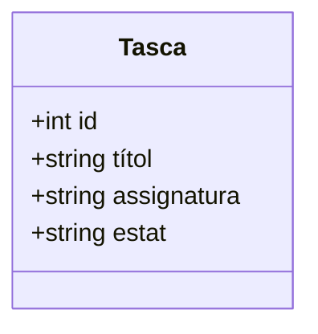
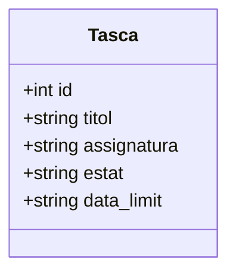

# SPECIFICATIONS.md — Sistema Tasks_app (v1.0)

## 1. Visió General
Tasks_app és una eina CLI lleugera per ajudar als estudiants a gestionar les seves tasques acadèmiques diàries.

## 2. User Stories (Històries d'Usuari)
- US-01: Com a estudiant, vull afegir una tasca amb títol i assignatura per recordar els meus deures.
- US-02: Com a estudiant, vull veure la llista de tasques pendents per organitzar el meu temps.

## 3. Model de Dades (Mermaid)

## 4. Requisits
- RF-01 : El sistema tasks_app ha de guardar les tasques en un fitxer JSON de persistència local.
- RF-02 : Si el fitxer `data/tasks.json` no existeix, el sistema tasks_app ha de crear `data/tasks.json`  inicialitzat amb una llista JSON buida ([])
- RF-03 : El sistema tasks_app ha de proveir a l'estudiant la capacitat de crear una nova tasca amb estat 'pendent' mitjançant el comandament add --title <títol> --subject <assignatura>.
- RF-04: El sistema tasks_app ha de proveir a l’estudiant la capacitat de visualitzar totes les tasques registrades (incloent-hi el seu ID, títol, assignatura i estat) mitjançant el comandament list.

## 5. Criteris d’acceptació i proves (Gherkin scenarios)
- GS-01: Creació correcta d'una tasca
  Atès que la base de dades JSON no conté encara tasques
  quan l’estudiant executa `python src/tasks_app.py add --title 'Pràctica 1' --subject 'RS'
  aleshores el sistema confirma `Tasca [ID: 1] creada amb èxit`
  i la tasca queda registrada al fitxer `data/tasks.json`.

- GS-02: Llistat de tasques quan `data/tasks.json` no conté registres 
  Atès que la base de dades JSON no conté encara tasques
  quan l’estudiant executa `python src/tasks_app.py list`
  aleshores el sistema mostra `Registre de tasques buit.` 

- GS-03: Llistat de tasques quan data/tasks.json conté registres
  Atès que el fitxer `data/tasks.json` conté les següents tasques:
    | id | títol          | assignatura | estat   |
    | 1  | Pràctica 1     | RS          | pendent |
    | 2  | Examen parcial | SO          | pendent |
  quan l’estudiant executa `python src/tasks_app.py list`
  aleshores el sistema mostra per pantalla:
    "[1] Pràctica 1 (RS) - estat: pendent"
    "[2] Examen parcial (SO) - estat: pendent"

## 6. Evolució Sprint 2: Dates Límit, Edició i Estats d'Urgència (v2.0)

### 6.1 User Stories (Sprint 2)
* **US-03:** Com a estudiant, vull assignar una data límit a una tasca en crear-la per controlar els terminis d'entrega.
* **US-04:** Com a estudiant, vull poder modificar qualsevol atribut d'una tasca existent (títol, assignatura o data límit) mitjançant el seu ID per corregir possibles errors de registre.
* **US-05:** Com a estudiant, vull marcar una tasca pendent com a completada per portar un seguiment del meu progrés.
* **US-06:** Com a estudiant, vull visualitzar etiquetes d'alerta (`[CADUCADA]` o `[URGENT]`) al llistat de tasques pendents per prioritzar les entregues més imminents.

### 6.2 Model de Dades Actualitzat (Mermaid)

### 6.3 Requisits (Patró SOPHIST)
* **RF-05:** El sistema `tasks_app` ha de proveir a l'estudiant la capacitat d'especificar opcionalment una data límit en format `YYYY-MM-DD` mitjançant el paràmetre `--due YYYY-MM-DD` en executar el comandament `add`.
* **RF-06:** El sistema `tasks_app` ha de proveir a l'estudiant la capacitat de modificar qualsevol atribut (`--title`, `--subject`, `--due`) d'una tasca existent identificada pel seu `--id <ID>` mitjançant el comandament `edit`.
* **RF-07:** El sistema `tasks_app` ha de proveir a l'estudiant la capacitat de canviar l'estat d'una tasca identificada per `--id <ID>` a `'completada'` mitjançant el comandament `complete`.
* **RF-08:** Si una tasca en estat `'pendent'` té una data límit estrictament inferior a la data actual del sistema, el sistema `tasks_app` ha de mostrar l'etiqueta `[CADUCADA]` al llistar-la amb `list`.
* **RF-09:** Si una tasca en estat `'pendent'` té una data límit igual o superior a la data actual i estrictament inferior a 7 dies vista (`0 <= dies_restants < 7`), el sistema `tasks_app` ha de mostrar l'etiqueta `[URGENT]` al llistar-la amb `list`.

### 6.4 Criteris d'acceptació i proves (Gherkin scenarios - Sprint 2)
* **GS-04: Creació d'una tasca amb data límit**
  Atès que la base de dades JSON està inicialitzada
  Quan l'estudiant executa `python3 src/tasks_app.py add --title 'Entrega SDD' --subject 'RS' --due 2026-12-01`
  Aleshores el sistema confirma `Tasca [ID: 1] creada amb èxit`
  I la tasca queda registrada a `data/tasks.json` amb el camp `data_limit` igual a `'2026-12-01'`.

* **GS-05: Modificació d'una tasca existent**
  Atès que existeix una tasca amb ID 1, títol `'Pràctica 1'`, assignatura `'RS'` i data límit `'2026-11-30'`
  Quan l'estudiant executa `python3 src/tasks_app.py edit --id 1 --title 'Pràctica 1 Corregida' --due 2026-12-05`
  Aleshores el sistema mostra `Tasca [ID: 1] actualitzada amb èxit`
  I el fitxer `data/tasks.json` actualitza el títol i la data límit mantenint l'assignatura `'RS'`.

* **GS-06: Completar una tasca**
  Atès que existeix una tasca amb ID 1 en estat `'pendent'`
  Quan l'estudiant executa `python3 src/tasks_app.py complete --id 1`
  Aleshores el sistema mostra `Tasca [ID: 1] marcada com a completada`
  I l'estat de la tasca passa a `'completada'`.

* **GS-07: Llistat amb etiquetes [CADUCADA] i [URGENT]**
  Atès que avui és `2026-11-24` i el registre conté les tasques pendents:
  - ID 1: `'Tasca antiga'` (`RS`), data límit `'2026-11-20'`
  - ID 2: `'Tasca propera'` (`SO`), data límit `'2026-11-28'`
  - ID 3: `'Tasca futura'` (`BD`), data límit `'2026-12-15'`
  Quan l'estudiant executa `python3 src/tasks_app.py list`
  Aleshores el sistema mostra:
  `"[1] Tasca antiga (RS) - estat: pendent - límit: 2026-11-20 [CADUCADA]"`
  `"[2] Tasca propera (SO) - estat: pendent - límit: 2026-11-28 [URGENT]"`
  `"[3] Tasca futura (BD) - estat: pendent - límit: 2026-12-15"`

## 7. Evolució Sprint 3: Modes Avançats de Llistat i Resum (v3.0)

### 7.1 User Stories (Sprint 3)
* **US-07:** Com a estudiant, vull consultar un resum estadístic de les meves tasques (total, pendents, completades, caducades i urgents) per tenir una visió global de la meva càrrega acadèmica.
* **US-08:** Com a estudiant, vull filtrar el llistat de tasques per una assignatura concreta per centrar-me en una matèria específica.
* **US-09:** Com a estudiant, vull cercar tasques mitjançant una paraula clau al títol per localitzar ràpidament una entrega o examen.

### 7.2 Requisits (Patró SOPHIST)
* **RF-10:** El sistema `tasks_app` ha de proveir a l'estudiant la capacitat de visualitzar un resum quantitatiu de les tasques registrades (total, pendents, completades, caducades i urgents) mitjançant el comandament `list --summary` (o el subcomandament `summary`).
* **RF-11:** El sistema `tasks_app` ha de proveir a l'estudiant la capacitat de filtrar les tasques per assignatura (sense distinció de majúscules o minúscules) mitjançant el paràmetre `list --subject <assignatura>`.
* **RF-12:** El sistema `tasks_app` ha de proveir a l'estudiant la capacitat de filtrar les tasques que continguin una paraula clau al títol (sense distinció de majúscules o minúscules) mitjançant el paràmetre `list --keyword <paraula_clau>`.

### 7.3 Criteris d'acceptació i proves (Gherkin scenarios - Sprint 3)
* **GS-08: Visualització del resum estadístic**
  Atès que el registre conté 4 tasques: 1 completada, 1 pendent caducada, 1 pendent urgent i 1 pendent futura
  Quan l'estudiant executa `python3 src/tasks_app.py list --summary`
  Aleshores el sistema mostra:
  `"Resum de tasques - Total: 4 | Pendents: 3 | Completades: 1 | Caducades: 1 | Urgents: 1"`

* **GS-09: Filtrat de tasques per assignatura**
  Atès que el registre conté tasques de `'RS'` i `'SO'`
  Quan l'estudiant executa `python3 src/tasks_app.py list --subject RS`
  Aleshores el sistema mostra únicament les tasques pertanyents a l'assignatura `'RS'`.

* **GS-10: Filtrat de tasques per paraula clau al títol**
  Atès que el registre conté les tasques `'Examen parcial'` i `'Pràctica 1'`
  Quan l'estudiant executa `python3 src/tasks_app.py list --keyword examen`
  Aleshores el sistema mostra únicament la tasca `'Examen parcial'`.